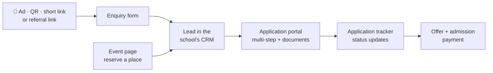

# Website and public pages

[← Back to overview](README.md)

## Clarvix marketing website (41 pages)

| Area | Pages |
|---|---|
| Product | Home, Platform, Features (access controls, attendance, family portal, fees, student pickup, teaching & learning, transport), Apps, Clever AI |
| Buying | Pricing, Compare, 4 cost calculators (subscription, bus tracking, QR attendance, total cost), Implementation |
| Try it | Interactive demo of the school admin portal, no sign-up |
| Company | About, Security, Contact, Careers, Blog, Docs |
| Legal | Privacy, Terms, Refund, Cookies, Data security, AI policy |
| Sign in | One page that sends admins, staff and families to the right portal |

## Each school's own public pages

Built from the school's Website Builder settings.

| Page | What it does |
|---|---|
| **Enquiry form** | Branded form with class, year and mobile |
| **Application portal** | Student, parents, previous school, siblings and document uploads (birth certificate, Aadhaar, TC, mark sheet). Save and continue on another device. |
| **Application tracker** | Status like "documents need attention" or "interview scheduled", plus the offer and payment |
| **Event page** | Reserve a place or join the waiting list, get a check-in code |
| **Referral link** | Sends the family to the enquiry form and credits the referring parent |
| **Short links** | Campaign links that lead to the enquiry form |
