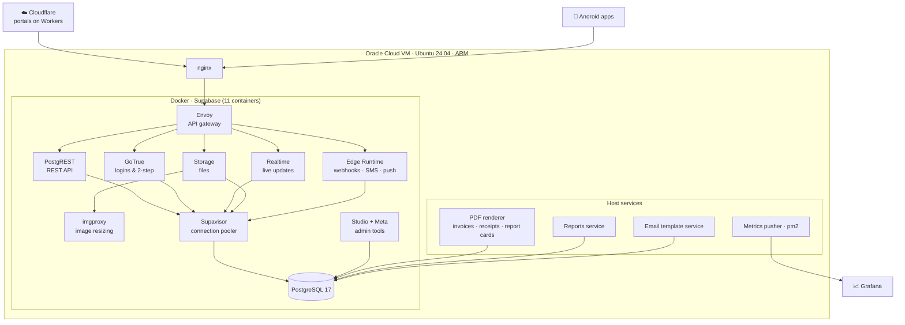
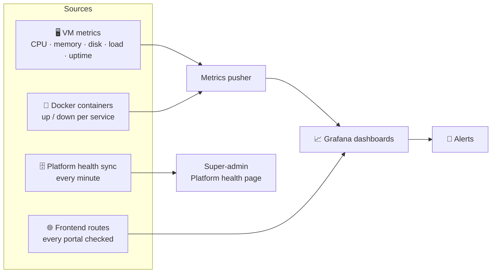
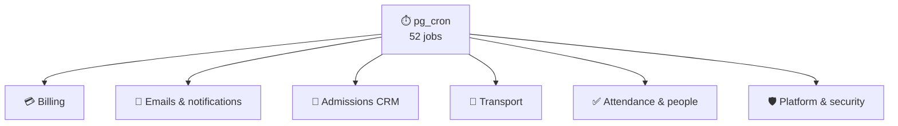
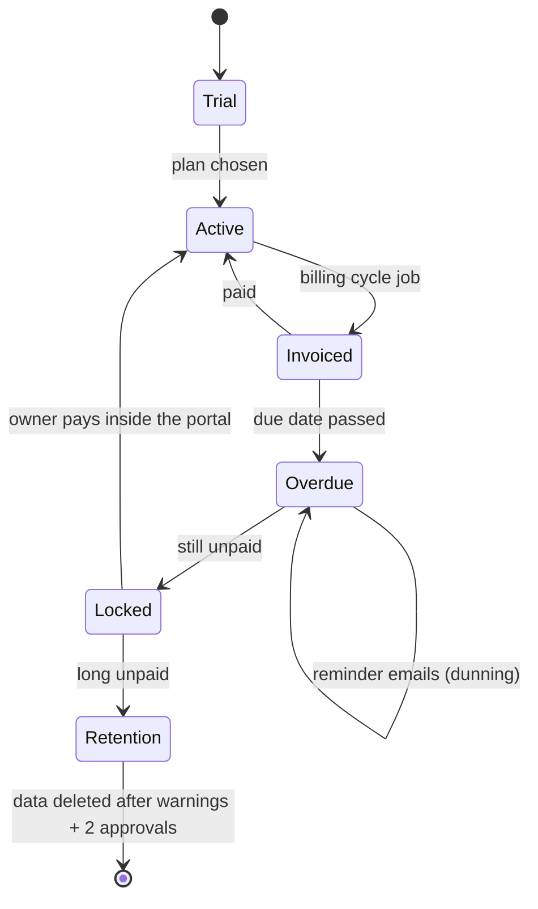
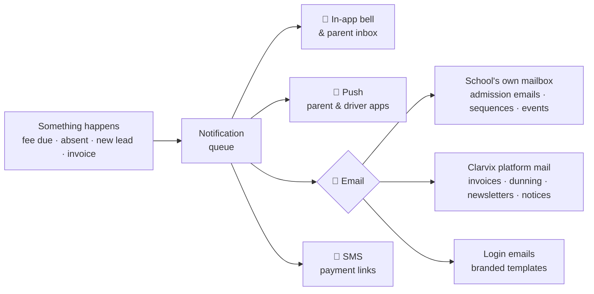
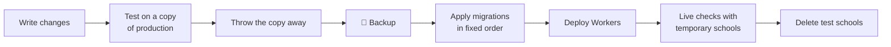

# Infrastructure and operations

How Clarvix is hosted, monitored and kept running. The whole backend is self-hosted: Supabase runs in Docker on one Oracle Cloud server, and the web apps run on Cloudflare.

[← Back to overview](README.md)

---

## Hosting at a glance

| Layer | What runs there |
|---|---|
| **Cloudflare Workers** | All web portals (school admin, teachers, parents, super-admin, website) |
| **Cloudflare R2** | Files: documents, receipts, report cards, app releases |
| **Oracle Cloud VM** | Ampere ARM, 2 vCPU, 12 GB RAM, Ubuntu 24.04 |
| **Docker on the VM** | Self-hosted Supabase in 11 containers |
| **Host services on the VM** | nginx, PDF renderer, reports service, email template service, metrics pusher (pm2) |
| **Database** | PostgreSQL 17 |
| **AI** | Claude on Azure AI Foundry |
| **Monitoring** | Grafana |

## Docker setup on the Oracle VM

| Container | Job |
|---|---|
| **PostgreSQL 17** | All data, security rules, business logic and scheduled jobs |
| **GoTrue** | Sign-in, sessions, 2-step verification |
| **PostgREST** | Turns the database into a REST API that respects row-level security |
| **Realtime** | Private per-school channels for chat, notifications, live bus map and attendance logs |
| **Storage** | File uploads and downloads |
| **Edge Runtime** | Backend functions for payment webhooks, SMS, push notifications and the bus tracker |
| **Supavisor** | Connection pooling so the database isn't flooded |
| **Envoy** | Gateway that routes every request to the right service |
| **imgproxy** | Resizes and optimizes images on the fly |
| **Studio + Meta** | Database admin tools |

### Postgres extensions in use

| Extension | Used for |
|---|---|
| `pg_cron` | 52 scheduled jobs |
| `pg_net` | Outgoing HTTP calls from the database (webhooks, notifications) |
| `pgmq` | Message queues |
| `pgcrypto` | Hashing and encryption |
| `pg_trgm` | Fuzzy search for names |
| `supabase_vault` | Storing secrets encrypted |
| `pg_stat_statements`, `index_advisor`, `hypopg` | Finding slow queries and testing indexes |
| `wrappers` | Foreign data wrappers |

---

## Monitoring with Grafana

| What's watched | How |
|---|---|
| Server CPU, memory, disk, load, uptime | Metrics pusher → Grafana |
| Every Docker container | Container status pushed to Grafana |
| Frontend portal routes | Route checks shown in Grafana |
| Scheduled jobs, workers, incidents | Platform health sync every minute → super-admin Platform health page |
| Payment gateways | Gateway incident monitor every 2 minutes |
| Live buses | Live transport monitor every 2 minutes |

---

## Automatic jobs (52, run by pg_cron)

| Area | Jobs | How often |
|---|---|---|
| **Billing & invoices** | Subscription billing cycle (auto invoices), dunning (payment reminders), school lifecycle (trials, renewals, locks), monthly student fee generation, payment gateway recovery | every 1–15 min |
| **Emails & notifications** | Comms automation, absent-student alerts to parents, homework publishing, parent learning alerts, email cleanup, notification retention | every 2–15 min, some daily |
| **Admissions CRM** | Follow-up, appointment, event and document reminders, offer expiry, email sequences, workflows, seat updates, nightly lead scoring, weekly forecast | every 2–30 min, nightly, weekly |
| **Transport** | Live bus monitor, stale driver check, document renewal alerts, daily trip automation, enrolment sync, GPS history cleanup | every 2–60 min |
| **Attendance & people** | Mark absent students, leave policy rules (nightly 11:30 PM IST), early pickup pass expiry, workforce automation | every 5 min, nightly |
| **Platform & security** | Device pairing sweep, privileged session expiry, ops watchdog, compliance, product automation, AI housekeeping, job log cleanup | every 5–60 min, daily |

## Subscription billing, fully automatic

- Invoices are created and emailed automatically, with PDF and GST details
- Reminders go out on a schedule before anything is locked
- A locked school can still pay from inside the portal, and unlocks right after payment

## Emails and notifications

| Channel | Used for |
|---|---|
| In-app | Staff bell and notification centre, parent inbox |
| Push | Parent app (tapping opens the exact item), driver schedule |
| Email (school's mailbox) | Admission status, follow-up sequences, event emails |
| Email (Clarvix) | Invoices, payment reminders, newsletters, notices, weekly digest, daily attendance summary |
| Email (login) | Branded sign-in, invitation and recovery emails |
| SMS | Payment links through the payment gateway |
| WhatsApp | Click-to-chat from the CRM with templates, sharing payment and referral links |

---

## Releases and backups

- 466 versioned migrations so far, each with a tested rollback where it changes existing behaviour
- A dated database backup is taken before every release and kept on the server
- Full disaster recovery tested at about 6.5 minutes
