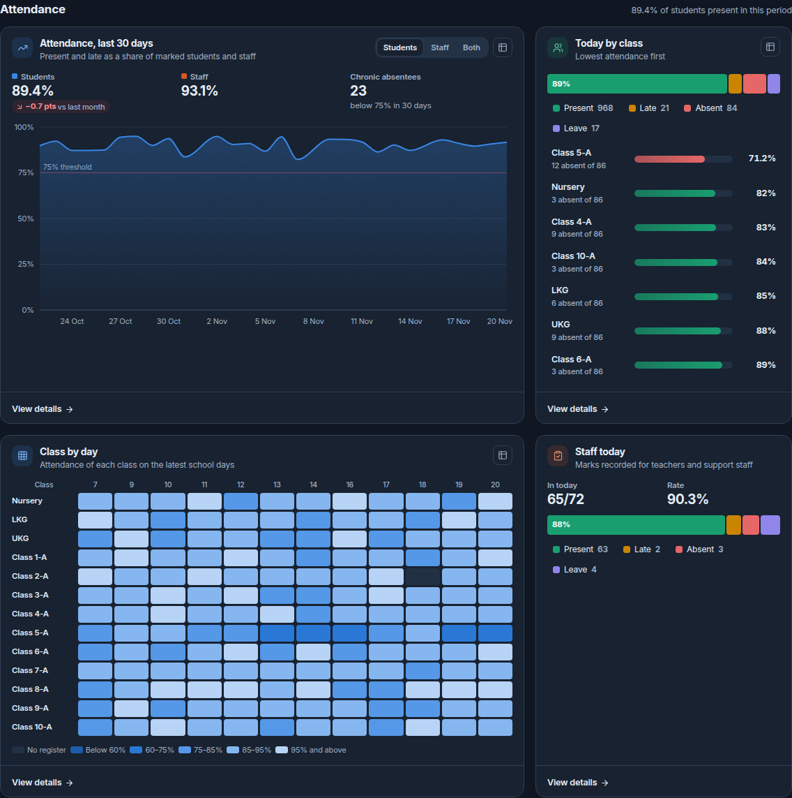
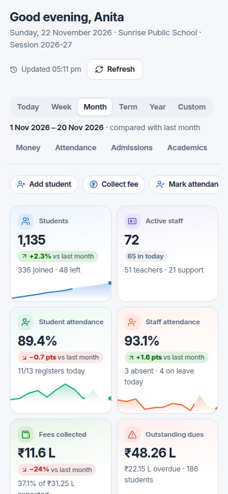
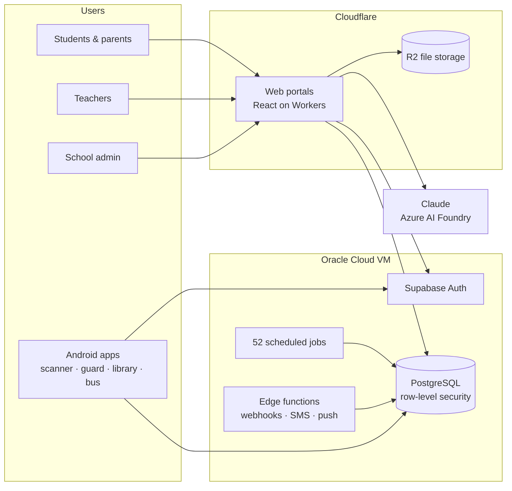
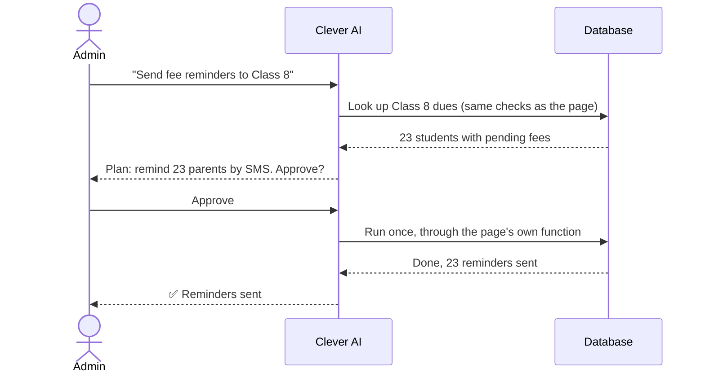
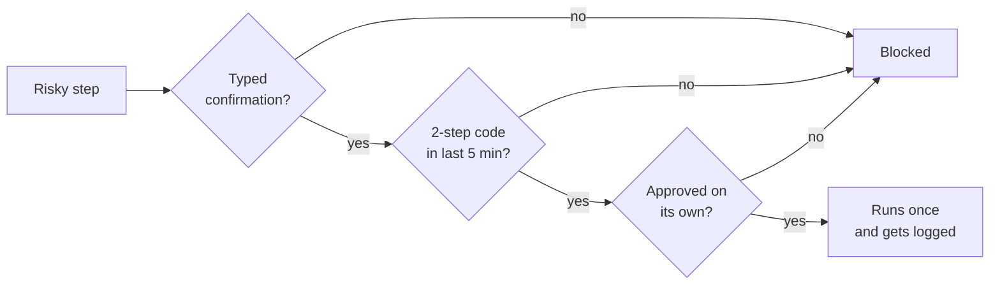
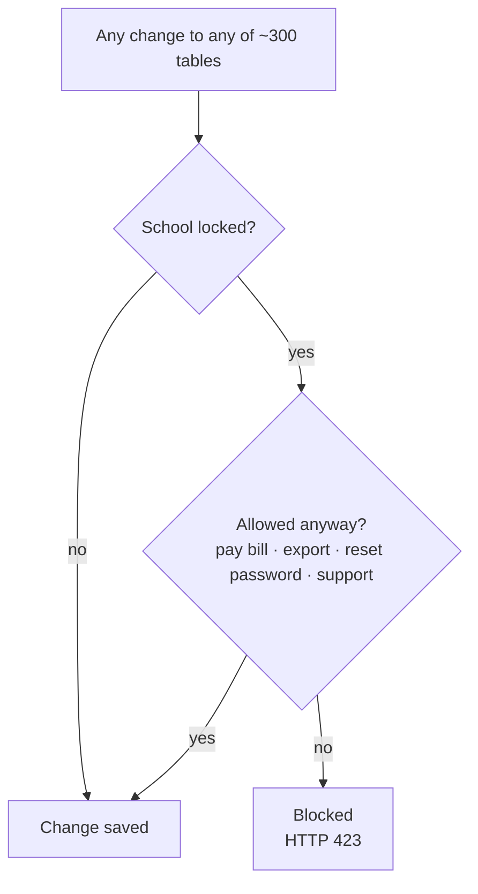
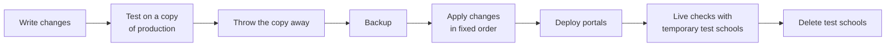

<h1 align="center">Clarvix</h1>

<p align="center">
<b>School management platform. Fees, attendance, admissions, exams, transport, library, HR, payroll and an AI assistant, all in one place.</b><br>
Built from scratch in 3 months, by me.
</p>

<p align="center">


</p>

<p align="center">
<a href="#-at-a-glance">At a glance</a> ·
<a href="#-screenshots">Screenshots</a> ·
<a href="#-architecture">Architecture</a> ·
<a href="#-clever-ai">Clever AI</a> ·
<a href="#-school-lock">School lock</a> ·
<a href="#-releases">Releases</a>
</p>


> The source code is private because it runs real school data. This repo shows what it does and how the main parts work.

---

## 📊 At a glance

| | |
|---|---|
| **Web portals** | 6 · school admin (105 pages), teachers, students & parents, super-admin, school website, parent app |
| **Android apps** | 5 · QR attendance scanner, gate guard, library desk, bus driver (live tracking), parent app |
| **Database** | PostgreSQL · 470+ tables · 1,700+ row-level security rules · 52 scheduled jobs |
| **Migrations** | 466 versioned, each one tested on a copy of production first |
| **AI** | Clever AI on Claude · answers questions and makes changes after approval |
| **Built in** | 3 months, from scratch, solo |

---

## 📸 Screenshots

**Fees and money**


| Attendance (dark mode) | On mobile |
|:---:|:---:|
|  |  |

<sub>Screenshots use demo data.</sub>

---

## 🏗️ Architecture



Every school's rows carry the school they belong to. Row-level security checks that the person asking is part of that school and can open that page. Anything that needs more power goes through a database function that reads the school from the user's login, never from what the browser sends.

---

## 🤖 Clever AI

An assistant inside the admin portal. Ask it anything about the school, or ask it to change something. It can only see what the logged-in admin can see, and it **never changes anything without asking first.**



**Extra protection for risky changes**, like deleting records, changing permissions or money going out:



A few more details:
- The 2-step check happens on the server, not in the browser.
- If the data changed since the plan was made, the step is refused.
- There are hundreds of possible actions, so the AI searches for the few tools it needs instead of loading all of them. Each request got about 78% smaller.
- It's tested with real questions, real changes and attempts to trick it: instructions hidden in a student's name, asking for another school's data, a staff member trying to do more than allowed.

---

## 🔒 School lock

If a school stops paying, hiding buttons isn't enough, because someone could still call the API directly. So **the database itself** blocks changes for that school.



On the apps, people can still sign in, but they see a lock screen and get logged out after a minute. A test runs on every release and fails if a new table is missing this check.

```sql
-- Simplified idea, not the real code
create function block_writes_when_locked() returns trigger as $$
begin
  if school_is_locked(current_school()) and not action_is_allowed() then
    raise exception 'school locked' using errcode = 'PT423';
  end if;
  return null;
end $$ language plpgsql;
```

---

## 🚢 Releases



Every change also has a tested rollback.

---

<p align="center">
Shivam Laur · <a href="mailto:proffesorrk@gmail.com">proffesorrk@gmail.com</a> · <a href="https://www.linkedin.com/in/shivam-kumar-28b40b306/">LinkedIn</a> · <a href="https://clarvix.co">clarvix.co</a>
</p>
