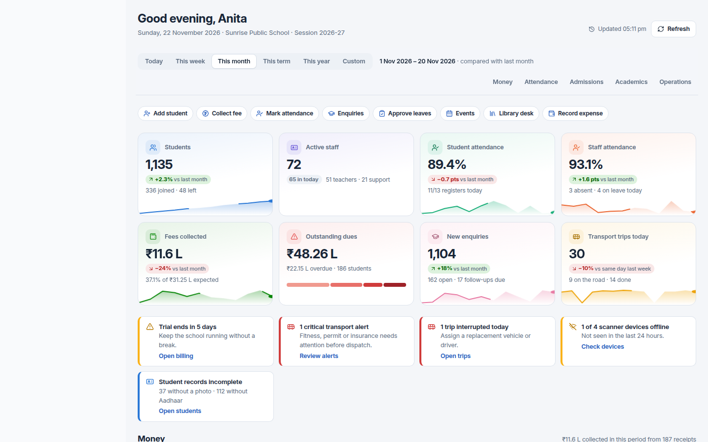
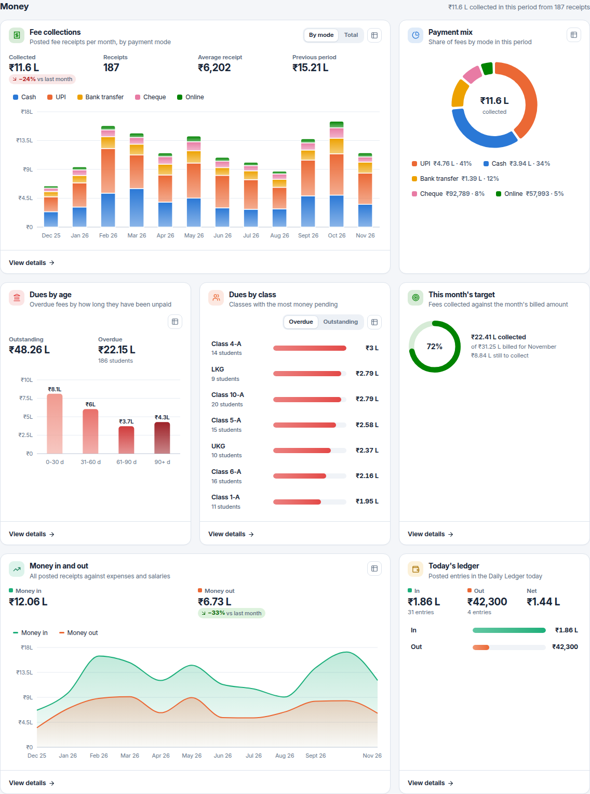

# Clarvix

A school management platform I built on my own. Schools use it for fees, attendance, admissions, exams, transport, the library, HR and payroll, with an AI assistant on top.

The source code is private because it runs real school data. This repo shows what it does and how the important parts work.



## What's in it

| Part | Details |
|---|---|
| Web portals (6) | School admin (105 pages), teachers and staff, students and parents, super-admin, school website and admission forms, parent app |
| Android apps (5) | QR attendance scanner (kiosk mode, works offline), gate guard, library desk, bus driver app with live tracking, parent app |
| Database | PostgreSQL with 470+ tables, 1,700+ row-level security rules, 52 scheduled jobs, 466 versioned migrations |
| AI | Clever AI, an assistant on Claude that answers questions and makes changes after approval |
| Hosting | Cloudflare Workers and R2 for the apps, self-hosted Supabase on an Oracle Cloud VM |

**Stack:** TypeScript, React (TanStack Start), Tailwind, Cloudflare Workers, Supabase / PostgreSQL, Kotlin, Expo, Claude API

## The management dashboard

Charts for fees, attendance, admissions, academics and operations, all switchable by period. Each section only shows up if the logged-in person has access to that area.



| Attendance (dark mode) | Mobile |
|---|---|
|  |  |

*Screenshots use demo data.*

## How the interesting parts work

### 1. Every school's data stays separate

Each row carries the school it belongs to. Row-level security policies check that the person asking belongs to that school and has access to that page. Anything that needs more power runs in a database function that takes the school from the logged-in user's token, never from what the browser sends.

```sql
-- Simplified idea, not the real code
create policy "members read their school's fees"
  on fee_payments for select
  using (school_id = current_school() and has_page_access('fees'));
```

### 2. A school that hasn't paid can't change anything

Hiding buttons isn't enough, because anyone can call the API directly. So the database itself refuses changes for a locked school. A statement-level trigger sits on around 300 tables and checks one lock rule. A few actions are allowed on purpose: paying the bill, exporting data, resetting a password and contacting support. The apps still let people sign in, but they show a lock screen and log out after a minute.

```sql
-- Simplified idea, not the real code
create function block_writes_when_locked() returns trigger as $$
begin
  if school_is_locked(current_school()) and not current_action_is_allowed() then
    raise exception 'school locked' using errcode = 'PT423';  -- becomes HTTP 423
  end if;
  return null;
end $$ language plpgsql;
```

A test runs on every release and fails if a new table is added without this trigger.

### 3. An AI assistant that asks before it changes anything

Clever AI runs on Claude. It reads data through the same checks the pages use, so it can only see what the logged-in admin can see. It never writes directly:

1. The admin asks for something, like "move Arjun to Class 5-B" or "send fee reminders to Class 8".
2. The AI prepares a plan. Each step shows what will change, for whom, and side effects such as "parents get an SMS".
3. Nothing happens until the admin clicks **Approve**. Each approval can only run once, and the plan is refused if the data changed in the meantime.
4. Risky steps, like deleting records or changing permissions, also need a typed confirmation and a 2-step code entered in the last five minutes. The server checks that, not the browser.

There are hundreds of possible actions, so the assistant first searches for the few tools it needs instead of loading all of them. That made each request about 78% smaller. I test it with hundreds of real questions and change scenarios, plus attempts to trick it: instructions hidden in a student's name, asking for another school's data, or a staff member trying to do more than they're allowed.

### 4. Releasing without breaking production

Every release goes through the same steps:
1. Run the database changes on a copy of production, then throw the copy away.
2. Take a backup.
3. Apply the changes in a fixed order and deploy.
4. Run live checks with temporary test schools that are deleted at the end.

Each change also has a tested way to roll it back.

## Contact

Shivam Laur · proffesorrk@gmail.com · [LinkedIn](https://www.linkedin.com/in/shivam-kumar-28b40b306/) · [clarvix.co](https://clarvix.co)
