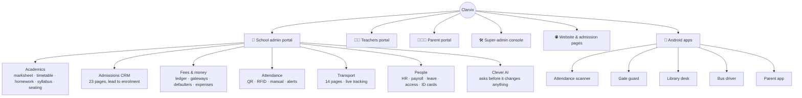
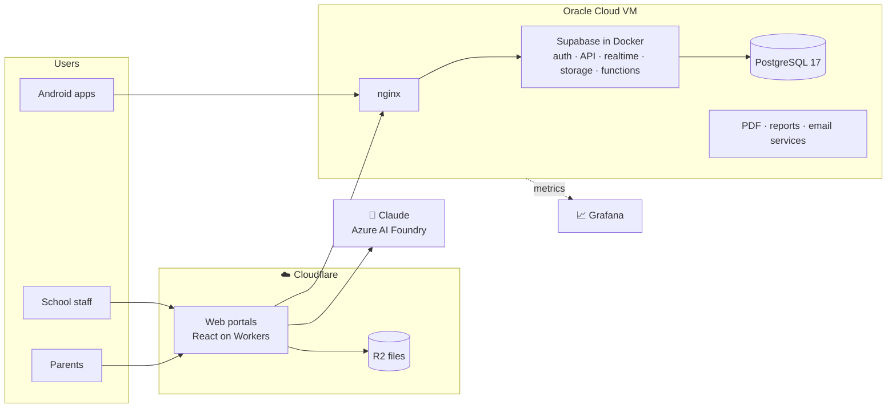
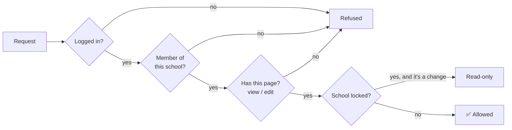
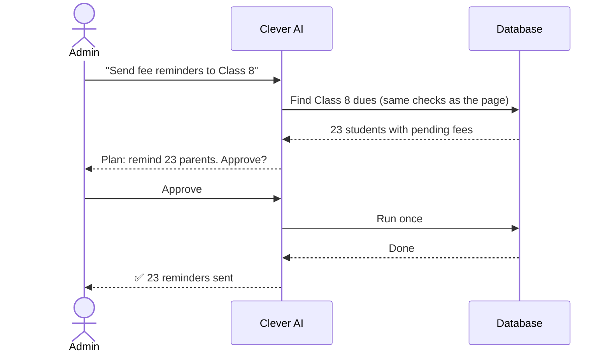

<h1 align="center">Clarvix</h1>

<b>An all-in-one school management platform.</b> 
Fees, attendance, admissions, exams, timetable, transport, library, HR, payroll and an AI assistant. 
Built from scratch in 3 months, solo.

> The source code is private because it runs real school data. This repo explains what the product does and how it's built.

---

## 📊 At a glance

| | |
|---|---|
| **Web portals** | 6 · school admin (~97 pages), teachers, students & parents, super-admin (36 pages), website (41 pages), parent app |
| **Android apps** | 5 · attendance scanner, gate guard, library desk, bus driver, parent app |
| **Database** | PostgreSQL 17 · 470+ tables · 1,700+ row-level security rules · 2,100+ functions |
| **Automation** | 52 scheduled jobs · auto invoices, reminders, alerts, scoring, monitoring |
| **Hosting** | Self-hosted Supabase in Docker on Oracle Cloud · portals on Cloudflare Workers |
| **Monitoring** | Grafana for the server, containers and frontend routes |
| **Releases** | 466 versioned migrations, all tested on a copy of production first |
| **Built in** | 3 months, from scratch, by one person |

---

## 🗺️ The whole product

## 📚 Detailed docs

| Doc | What's inside |
|---|---|
| [School admin portal](01-school-admin-portal.md) | Every sidebar section and page, with flow charts for admissions, attendance, fees, transport and payroll |
| [Teachers portal](02-teachers-portal.md) | Teaching pages, and how the owner grants access page by page |
| [Parent portal](03-parent-portal.md) | Learn, fees, inbox, transport and more |
| [Super-admin console](04-super-admin-console.md) | Running the platform: schools, billing, product, support, compliance |
| [Android apps](05-android-apps.md) | All 5 apps, screen by screen |
| [Website & public pages](06-website-and-public-pages.md) | Marketing site and each school's admission pages |
| [Infrastructure & operations](07-infrastructure-and-operations.md) | Docker setup, Grafana monitoring, 52 jobs, emails, billing automation, releases |

---

## 🏗️ How it's built

Full container-by-container diagram: [Infrastructure & operations](07-infrastructure-and-operations.md).

---

## 🔒 Every school's data stays separate

Every row belongs to one school. Row-level security checks that the person asking is part of that school and has access to that page. Staff permissions go down to single pages, and the database checks the same permission on every read and every change.

## 🔐 School lock

If a school stops paying, **the database itself** blocks every change on around 300 tables, so it can't be worked around through the API. Paying the bill, exports, password reset and support still work on purpose.

| Who | What they see |
|---|---|
| School owner | Portal becomes read-only, with a pay button |
| Staff and parents | Lock screen with a 1-minute countdown, then logged out |
| Device apps | Pause and keep their data, carry on after unlock |
| Clever AI | Makes no changes |

## 🤖 Clever AI

An assistant inside the admin portal that can answer anything about the school and make changes. It **never changes anything without asking first.**

- It only sees what the logged-in person can see
- Every change is shown as before → after, then approved
- Risky changes (deletes, permissions, money going out) also need a typed confirmation and a 2-step code from the last 5 minutes, checked on the server
- It searches for the few tools it needs out of hundreds, which made each request about 78% smaller
- Tested with hundreds of real questions, real changes and attempts to trick it

---

Shivam Kumar · <a href="mailto:proffesorrk@gmail.com">proffesorrk@gmail.com</a> · <a href="https://www.linkedin.com/in/shivam-kumar-28b40b306/">LinkedIn</a> · <a href="https://clarvix.co">clarvix.co</a>

