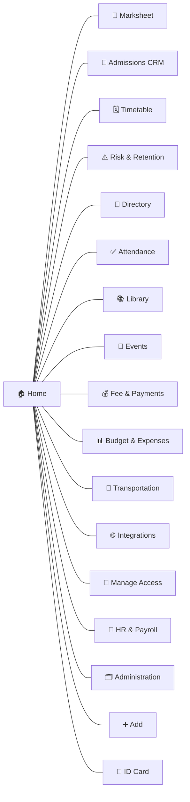
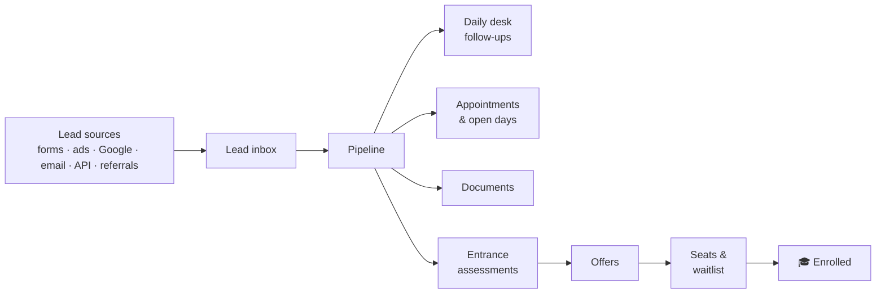
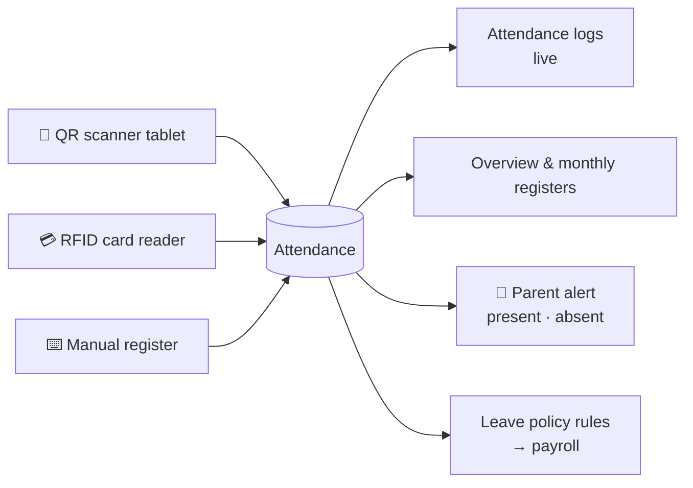
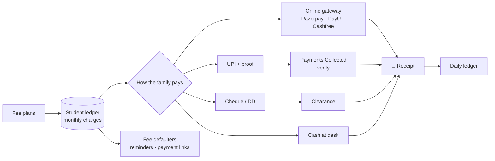
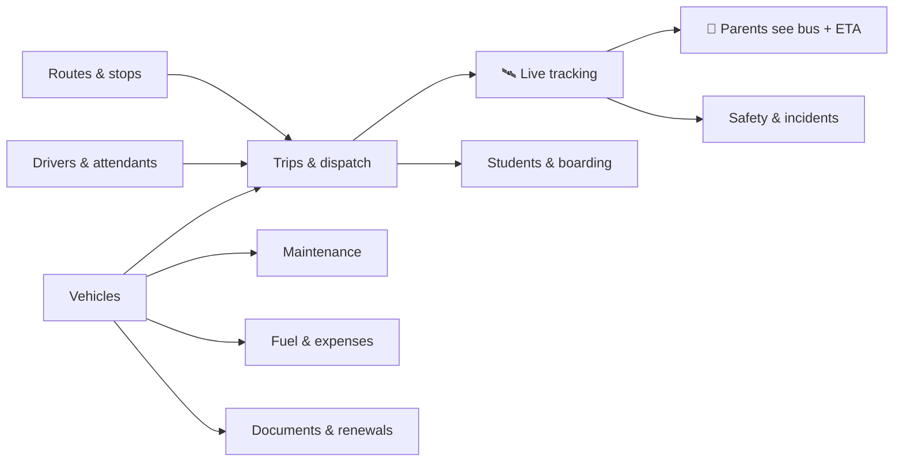
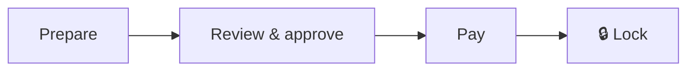

# School admin portal

The main portal for the school owner and the staff they give access to. About 97 pages, organized in the sidebar below.

[← Back to overview](../README.md)

---

## Contents
- [Top bar](#top-bar)
- [Home dashboard](#home-dashboard)
- [Marksheet](#marksheet)
- [Admissions CRM](#admissions-crm)
- [Timetable](#timetable)
- [Risk & Retention](#risk--retention)
- [Directory](#directory)
- [Attendance](#attendance)
- [Library](#library)
- [Events](#events)
- [Fee & Payments](#fee--payments)
- [Budget & Expenses](#budget--expenses)
- [Transportation](#transportation)
- [Integrations](#integrations)
- [Manage Access](#manage-access)
- [HR & Payroll](#hr--payroll)
- [Administration](#administration)
- [Add](#add)
- [ID Card](#id-card)
- [Footer tools](#footer-tools)
- [Settings, account and Clever AI](#settings-account-and-clever-ai)

---

## Top bar
- Global search (Ctrl K) across pages and actions
- Pin any page
- Network speed check and refresh
- Notifications bell
- Profile menu: My Account, school settings, switch academic session, theme, sign out (optionally from every device)
- Plan expiry and Clarvix announcement banners

## Home dashboard
A management dashboard that only shows the sections the person has access to. Staff with none of them see a personal teaching dashboard instead.

| Section | What it shows |
|---|---|
| Needs your attention | Leaves, payments to verify, concessions, overdue items |
| Attendance | Today by class, class-by-day heatmap, 30-day trend, staff today |
| Money | Collections against billed amount, payment mix, dues by age and class, money in and out, today's ledger |
| Admissions | New enquiries, pipeline funnel, conversion, seats filled, monthly target |
| Academics | Homework and lesson plan completion, syllabus progress, the week ahead |
| Operations | Transport trips by status, library loans and returns due |

Charts animate when filters change, keep the same colour for the same thing everywhere, and each one has a table view.

---

## Marksheet

| Page | What you can do |
|---|---|
| **Exams & results** | Open an exam with template, subjects, grading bands and release date. Track each class from marks entry → review → verification → published. Send a class back for correction. Analytics for toppers, distributions and students needing attention. |
| **Template designer** | Design, version and publish report card templates. See who is responsible for design, review and publishing. |
| **View Marksheet** | Library of result records with filters and each student's history. Import marks from a file, a Google Sheet or a class grid, map columns, fix every row, then import. |

## Admissions CRM

| Page | What you can do |
|---|---|
| **Overview** | Today's priorities and appointments. Reports on funnel, sources, team, documents, offers, seats and calls, with date, year, class and counsellor filters. |
| **Pipeline** | Kanban board or table, swimlanes by class, source or counsellor. Each applicant has Overview, Activity, Tasks, Documents, Admission and Details tabs. |
| **Lead inbox** | Every enquiry as it arrives from forms, ads, Google lead forms, email and API. Merge into an existing applicant. |
| **Daily desk** | My next actions for the next 24 hours, and every follow-up to resolve with an outcome. |
| **Calls & messages** | One-tap call and WhatsApp from every list, outcomes logged, WhatsApp templates. |
| **Appointments** | One calendar for campus visits, assessments, interviews and counselling. |
| **Events & open days** | Open days, linked to the Events page. |
| **Families** | Households, guardians and siblings grouped together, with suggestions from shared phone numbers. |
| **Documents** | Verify documents or ask for corrections. The family's tracker and emails update by themselves. |
| **Duplicate review** | Mark matches as the same application or as siblings. |
| **Seats & waitlist** | Seat capacity per class and year, live usage, and a waiting list that fills freed seats. |
| **Offers** | Offer letters with deadline and fee lines, acceptance tracking, PDF and versions. |
| **Entrance assessments** | Tests with subjects, marks and weightage. A merit list and cut-off turn into offers and a waiting list. |
| **Automation** | Assignment rules, stage checklists, response deadlines, and custom "when X, if Y, then Z" rules. |
| **Sequences** | Timed follow-up emails from the school's own address. They stop when the family moves ahead or unsubscribes. |
| **Targets & forecast** | Targets by class and counsellor, pace against target, and a forecast from the current pipeline. |
| **Lead sources** | Forms, ad links, short links, Google Ads webhook and lead email, with health checks, embeds and QR codes. |
| **Referrals** | Parent referral links and codes, credit from first visit to enrolment, rewards to approve. |
| **Lead scoring** | A clear 0–100 score with reasons and adjustable weights. |
| **Import leads** | CSV or Excel up to 5,000 rows, with column mapping and duplicate checks. |
| **Intake settings** | Intake dates, classes and documents, follow-up timing, custom fields, offers, public application link. |
| **Pipeline stages** | Pipelines per intake, mapped to admission milestones. |
| **Email settings** | Branded admission emails from the school's own mailbox: connection, templates, delivery history. |

## Timetable
- **Views:** today, by class, teacher or room, or the whole school
- **Builder:** generate or copy a draft, edit with live clash detection, publish to the teacher and parent apps
- **Cover desk:** absent teachers, affected lessons and who covers them
- **Workload, curriculum and history:** compare and restore versions, export

## Risk & Retention
- Students at risk by term, with high and medium risk counts and trends
- Saved views: all flagged, high risk with no action, follow-ups due, unassigned
- Per student: marks evidence, call parent, log an intervention, assign an owner, resolve

## Directory

| Page | What you can do |
|---|---|
| **Students** | Active, graduated and left counts, missing documents, bus users. Saved views, bulk actions, export. Profile tabs: Overview, Academics, Fees (month ledger + collect fee), Documents, Attendance, Activity. |
| **Student Leaves** | Approve or reject leave requests from families, with documents. |
| **Doubt Tickets** | Student doubts, answered by text, voice, video or photo annotation. |
| **Exam Seating** | Seating plans by class and room, mixing grades on every bench. Room map, student list, issues. |
| **Class Notes** | Upload up to 20 files at once, filters, recently deleted bin. |
| **Class Videos** | Recorded lectures with views, completion and watch time. |
| **Homework** | Assigned, needs review, due today, past due, submission rate. Review and request changes. |
| **Syllabus Tracker** | Chapter plans with coverage worked out from teaching logs. |
| **Early Pickup** | Pickup requests, guardians, gate log, visitors, incidents and guard devices. |

## Attendance

| Page | What you can do |
|---|---|
| **Overview** | Live register status, trends, at-risk students, monthly registers for students and staff. |
| **Attendance Logs** | Every scan, card tap and manual mark for the day, updating live. |
| **Manual Attendance** | Fast keyboard register that merges safely with scanner and card marks. |
| **Attendance Config** | Scan window, late rule, automatic absences, QR scanners, RFID cards, parent alerts. |
| **QR Scanner Devices** | Pair, rename, disable and monitor scanner tablets, kiosk PIN. |

## Library
- **Tabs:** Overview, Circulation desk, Catalogue, Loans, Members, Fines, Settings
- **Circulation desk:** one scan box for barcode, ISBN or admission number to issue or return
- **Loans and fines:** overdue reminders, renewals, collect or waive fines with an audit trail

## Events
- Open House, Campus Tour, Webinar, Parent-Teacher Meeting, Alumni Meet
- Registrations, waiting list, check-in and attendance
- Links each registration to an enquiry, with automatic emails including a day-before reminder

## Fee & Payments

| Page | What you can do |
|---|---|
| **Invoices** | Receipts register, student ledger (monthly fees, charges, collections, adjustments and refunds) and fee plans. Collect fees, concessions, waivers, refunds, approval limits. |
| **Invoices Templates** | Design invoices, receipts and payslips: branding, sections, watermark. |
| **Payments & API** | UPI QR and online gateways (Razorpay, PayU, Cashfree), test connection, go-live checklist. |
| **Payments Collected** | Verify or reject UPI proofs, cheque and DD clearance, proof and audit per payment. |
| **Fee Defaulters** | By student, class or fee head, with aging, follow-ups and bulk reminders. |
| **Daily Ledger** | Every money movement by day, review queue, cash count and day closing. |
| **Accessories** | School store for books, uniforms and accessories, with stock and sales billed to the fee ledger. |
| **Payment Links** | Gateway payment links from a student's balance, sent by SMS or WhatsApp, with tracking. |
| **My Subscription** | Clarvix plan, invoices, pay invoice, usage meters for students, storage, SMS and AI. |

## Budget & Expenses
- Expense register, bills and approvals, budgets, vendors
- Approval authority settings and CSV export

## Transportation

| Page | What you can do |
|---|---|
| **Overview** | Today's operations, action queue, transport policy. |
| **Vehicles** | Fleet register with compliance, open work and running cost per bus. |
| **Live Tracking** | Realtime fleet map, current trips, SOS and incident alerts. |
| **Routes & Stops** | Plan stops on a map, assign driver and riders, see unassigned students. |
| **Trips & Dispatch** | Generate the day's trips, readiness checks, dispatch, manifest. |
| **Students & Boarding** | Live boarding register per trip. |
| **Drivers & Attendants** | Licences, reviews, driver phone pairing by 6-digit code or QR. |
| **Documents & Renewals** | Vehicle papers and licences with expiry alerts. |
| **Maintenance** | Work orders, odometer-based service schedule, pre-trip inspections. |
| **Fuel & Expenses** | Fuel logs with receipts, mileage, expense ledger. |
| **Safety & Incidents** | Report, investigate and close incidents. |
| **Vendors & Contracts** | Partners, renewals, payments. |
| **History** | Full change history and GPS route replay. |
| **Reports** | Cost, trips, compliance and safety reports. |

## Integrations

| Page | What you can do |
|---|---|
| **Website Builder** | The school's public enquiry form, application portal and application tracker. Design, content, form fields and versions. |
| **Website Tools** | Links and QR codes, form embed, floating widget. |

## Manage Access

| Page | What you can do |
|---|---|
| **Student Access** | Parent access requests, ID card QR codes, private registration codes, family change requests, parent app settings. Suspend access or sign a family out. |
| **Staff Access** | Members, invitations, access review. Invite wizard: details → page access (view or edit) → features → review. |

## HR & Payroll

- Employees, payroll runs, statutory (PF, ESI, professional tax, TDS), history and audit
- Employee profile tabs: Overview, Profile, Compensation, Payslips, Attendance & leave, Documents, History
- 12-month payroll cost chart
- **Payroll Templates:** payslip designer
- **Personal pages:** My Profile and Apply Leave (Sick, Casual, Medical, Personal, Emergency)

## Administration

| Page | What you can do |
|---|---|
| **Leave Approvals** | Pending, overdue, on leave today, payroll follow-up, with balances and who else is away. |
| **Leave Policy Rules** | Turn late and absent marks into deductions. Runs nightly at 11:30 PM IST. |
| **Teaching Logs** | What was taught and by whom, with homework and voice briefings. |
| **Lesson Plans** | Teaching calendar, flags lessons that need a substitute. |

## Add
- **Student:** guided admission in 5 steps (student, class, family, documents, review), with duplicate check, saved draft and photo crop
- **Teacher and Staff:** guided onboarding into HR

## ID Card

| Page | What you can do |
|---|---|
| **ID QR Generate** | Issue, replace and revoke ID QR codes, coverage by class, QR sheet PDFs. |
| **ID Card Templates** | Default design per holder type, design library with versions. |
| **ID Card Designer** | Choose people → fix photos and QR → preview → print PDF. |

---

## Footer tools

| Tool | What it does |
|---|---|
| **X. Marketplace** | Templates for report cards, invoices, receipts, payroll, admission pages and ID cards |
| **X. Store** | Install and update the official Clarvix Android apps |
| **X. Chat** | School chat with groups, replies, reactions, read receipts, files, mentions, search |
| **Clever AI** | Ask anything (Alt+Shift+C), side panel or full page |
| **Tasks** | List, board or calendar view |
| **Announcements** | Compose, target, schedule, pin and track reads |
| **Notes** | Folders, tags, rich text, sharing |
| **Drive** | Personal files, large uploads, previews, sharing |
| **Help** | Guides, shortcuts, what's new, getting-started checklist |
| **Support** | Raise tickets with category and urgency, track replies, rate |

## Settings, account and Clever AI

| Page | What you can do |
|---|---|
| **Notifications centre** | Inbox, unread, snoozed, archived. Preferences per category for bell and email, daily attendance summary, weekly digest. |
| **Settings** | School profile, academic years and the year-end wizard (promotions, graduates, new session), Clever AI access level, data exports, change history. |
| **My Account** | Personal info, password, authenticator app plus backup, signed-in devices, usage and limits. |
| **Clever AI** | Chat with school data, answers with tables, charts and "how I got this". Action plans with before → after for every step, approved one by one. |
