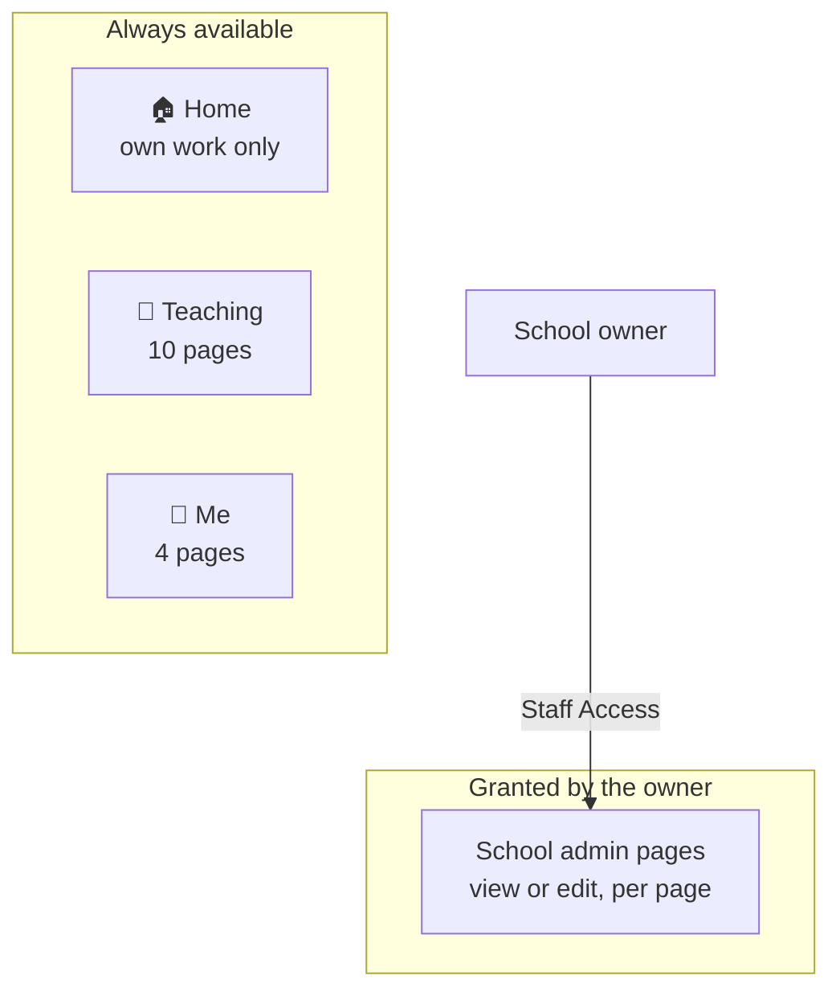
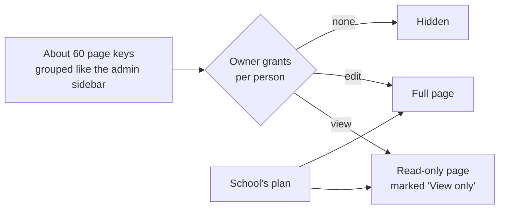

# Teachers and staff portal

Every staff member gets their own teaching pages. On top of that, the owner can give each person access to any admin page, one page at a time, as view or edit.

[← Back to overview](../README.md)

## Home
Only the teacher's own work: today's periods, attendance to mark, homework to review, doubts assigned, lesson plans due, teaching logs not filled, announcements. Granted admin pages appear as links, never as data on the home page.

## Teaching

| Page | What you can do |
|---|---|
| **My timetable** | Own periods by day or week, cover duties, lessons covered by others. |
| **My class** | For class teachers: students, attendance marking, fees, approve leaves, notices. |
| **Marks register** | Enter marks for own subjects, see own exams, review and publish. |
| **My homework** | Own assignments and submissions. |
| **My doubts** | Reply by text, voice or video, annotate photos. Parents are notified. |
| **My lesson plans** | Plan each period; administration can see them. |
| **Teaching log** | Record what was taught; feeds the syllabus tracker. |
| **Class notes & videos** | Upload study material for own classes. |
| **Student remarks** | Remarks and voice notes that show on the profile and report card. |
| **Class notices** | Notices to parents of own classes. |

## Me

| Page | What you can do |
|---|---|
| **My profile** | Personal and job details. |
| **My leave** | Apply and track. |
| **My salary** | Own payslips once payroll is approved. |
| **My expenses** | Reimbursement claims. |

## How admin access works

- Each admin page has its own key, so access can be as narrow as one transport page
- Salary and payroll data has its own sensitive key and is never part of "select all"
- New grants show a "New" badge in the sidebar
- Feature grants control footer tools like chat, tasks, notes, drive and the app store
- The server checks the same key on every read and every change
- **Never given to staff:** Payments & API, My Subscription, Staff Access, CRM email settings, Settings, year-end wizard, Clever AI

Sign-in includes invitations, approval, 2-step setup and recovery, and a lock screen if the school is locked.
