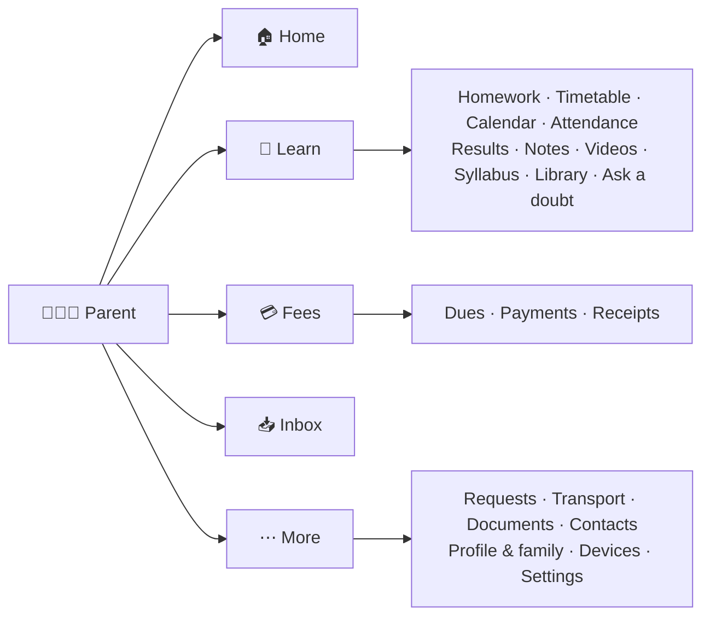
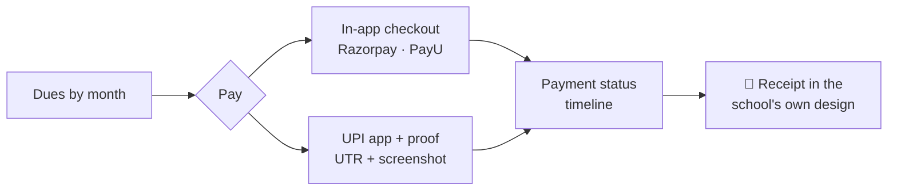

# Student and parent portal

For families. Works on the web and as an Android app. Five sections: **Home, Learn, Fees, Inbox, More**. A child switcher is included for families with more than one child.

[← Back to overview](../README.md)

## Home
What needs attention, homework due, latest from school, quick actions.

## Learn

| Page | What you see |
|---|---|
| **This week** | Homework and attendance this week, today's classes, new material, alerts. |
| **Homework** | Due soonest first, submit or acknowledge, feedback and attachments. |
| **Timetable** | Today with the current period highlighted, or the full week; cover lessons. |
| **Calendar** | Exams (with the child's room and seat), holidays, events, leave. |
| **Attendance** | Monthly calendar, day details, 6-month trend. |
| **Results** | Report cards with trends, view in the app or download PDF. |
| **Notes and Videos** | By subject, with "continue watching". |
| **Syllabus** | Progress by subject and chapter. |
| **Library** | Books borrowed, due dates, fines. |
| **Ask a doubt** | Pick a teacher, attach a photo. |

## Fees

- Problems first: payments waiting or failed, UPI started without proof, unfinished checkout
- One status for every payment, with a timeline and CSV export
- Receipts in the school's template, plus a statement per session

## Inbox
Notifications and school notices together. Tapping a push notification opens the exact item.

## More

| Page | What you can do |
|---|---|
| **Requests** | Apply for leave, request early pickup passes, see doubt history. |
| **Transport** | Live bus map, ETA to your stop, today's status, last 7 days, bus alerts. |
| **Documents** | Report cards, certificates, receipts, notice attachments, own uploads. |
| **School contacts** | Office, class teacher, transport desk. |
| **Profile & family** | Child details, guardians, add a child, request phone or address changes. |
| **Sign-in & devices** | Active sessions, sign out other devices. |
| **Notifications & settings** | Preferences for fees, learning, requests and transport. |

## Also included
- Registration with a school code, verified by ID card QR, school approval or a private code
- Report card verification page that checks if a downloaded PDF is genuine
- Families keep read-only access to documents and results for 180 days after leaving
- Lock screen if the school is locked
