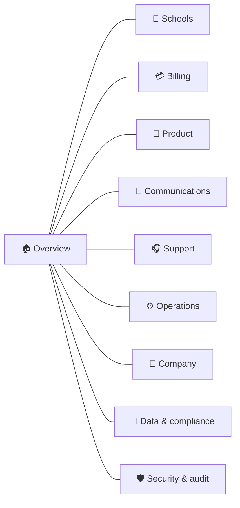
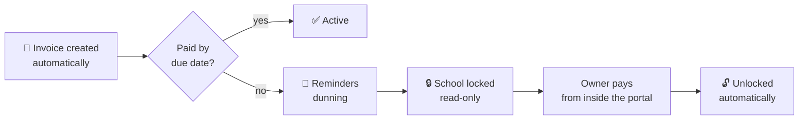

# Super-admin console

Where Clarvix itself is run: schools, billing, product, communications, support, operations, company HR, compliance and security. 36 pages. Every Clarvix employee only sees what their role allows. Sign-in needs 2-step verification, and sensitive actions ask for it again.

[← Back to overview](../README.md)

## Overview
- **Home:** one "needs attention" inbox across billing, product, schools, failed jobs and platform health
- **Approvals:** one queue for anything that needs a second person

## Schools

| Page | What you can do |
|---|---|
| **All schools** | Onboarding, trial, active, past due, suspended and churned views, bulk actions, export. |
| **School 360** | One school's overview, subscription, invoices, access, AI, usage, support and activity. Change plan, limits and trial end. |
| **Onboarding** | New school wizard: profile → plan & trial → admin invite → setup checklist. |
| **School diagnostics** | Read-only troubleshooting for parents, payments, gateways and sessions. Opens only inside a logged support session with a reason. |
| **CRM pipeline** | Clarvix's own sales pipeline with follow-ups and hand-off to onboarding. |

## Billing

| Page | What you can do |
|---|---|
| **Invoices** | Unpaid, overdue, paid, waived, credit notes, GST review. |
| **Collections** | Ageing, dunning, unapplied payments, payment attempts, worker health. |
| **Plans & pricing** | Plan catalogue and price by school size. |
| **Gateways & GST** | Payment gateways and invoice details. |

## Product

| Page | What you can do |
|---|---|
| **Plans & access** | Which modules each plan (Basic, Air, Max) includes, per-school overrides, limits on students, SMS and storage. |
| **AI** | Clever AI per school, usage and quality, add-on settings, switches. |
| **Releases** | Android app versions for X. Store: stable, beta and internal channels, promote or pull a release. |
| **Devices & apps** | Every scanner, card reader, driver phone, guard device and library login across schools, with status and minimum app version. |
| **Templates** | Moderate marketplace templates. |

## Communications

| Page | What you can do |
|---|---|
| **Broadcasts** | Announcements, maintenance and incident notices, with a second approver, targeting and read tracking. |
| **Newsletter** | Campaigns, templates, subscribers, batched sending with retries. |
| **Email deliveries** | Delivery log, school SMTP health, suppressions, templates. |
| **Publishing & hiring** | Blog posts, jobs and applicants. |

## Support
**Ticket desk:** queues for mine, unread, unassigned and SLA breached, plus canned replies, internal notes, merge, school context, engineering hand-off, satisfaction ratings.

## Operations

| Page | What you can do |
|---|---|
| **Platform health** | Jobs, workers, infrastructure, incidents, runbooks, errors and logs. |
| **Usage analytics** | Schools at risk, module adoption, busy hours, storage. |

## Company
Clarvix's own HR: people, attendance and leave, payroll, team roles and temporary access, sessions, audit trail, and each employee's own HR page.

## Data & compliance

| Page | What it covers |
|---|---|
| **Compliance** | Activity log and checks |
| **Terms & agreements** | Acceptance per school and re-acceptance |
| **Data exports** | Full archive of one school (asks for 2-step again) |
| **Retention & deletion** | Retention clocks after a subscription ends, warnings at 30, 7 and 1 days, deletion needs two people |
| **DPDP requests** | Access, correction, erasure, consent withdrawal and grievances with deadlines |
| **Data incidents** | Breach register with CERT-In 6-hour and DPDP 72-hour clocks |

## Security & audit
Audit log of every action, security events, and your own sessions.
