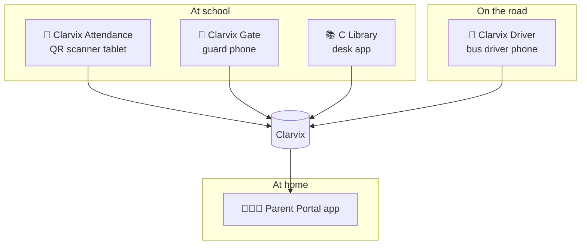
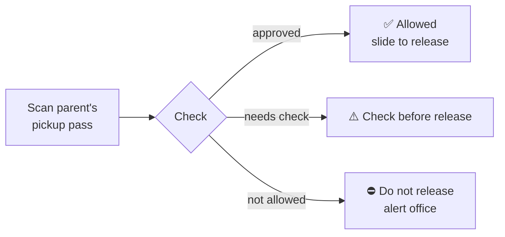
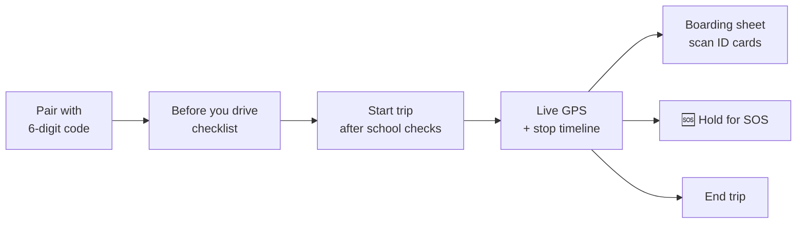

# Android apps

Five apps, all signed releases and installed through Clarvix's own app store (X. Store). The device apps pair with a school using a 6-digit code or QR, work offline, and support English and Hindi.

[← Back to overview](../README.md)

---

## 📱 Clarvix Attendance (QR scanner tablet)

| Feature | Details |
|---|---|
| Pairing | Pair with the school, accept terms, set a device PIN |
| Scanning | Reads ID card QR codes. Results: marked, already marked, outside window, unknown card, saved offline. Sounds and vibration. |
| Today | Who isn't marked yet, late arrivals |
| Manual marking | Search by name or admission number, needs the school PIN |
| Queue | Scans waiting to upload, problems to review, export |
| Kiosk mode | Locks the tablet to the app with screen pinning and asks for the PIN to leave |
| Offline | Downloads card data to check scans with no internet, uploads later in batches |
| Rules | Follows the school's scan window and late rule |

## 🚪 Clarvix Gate (guard phone)

| Feature | Details |
|---|---|
| Setup | Pair with a gate code, unlock with fingerprint or PIN |
| Today at this gate | Visitors on site, open incidents, passes waiting |
| Pickup passes | Scan the parent app QR. Shows the authorised guardian and who is collecting. |
| Visitors | Check in with name, mobile, whom they're meeting, vehicle, ID and photo, then check out |
| Incidents | Report with an optional photo |
| Shift handover | Refused scans, visitors, open incidents, notes |
| Outdoors | High-contrast mode, offline queue |

## 📚 C Library (desk app)

| Feature | Details |
|---|---|
| One scan box | Camera, USB or Bluetooth scanner. Reads ID card QR, book barcode, ISBN or admission number. |
| Circulation | Issue, return, renew, holds, lost or damaged, fines |
| Catalogue | Add titles from the barcode, add copies |
| Today | Due today, holds ready, fines collected |
| Offline | Nothing is lost; refused items wait for review |

## 🚌 Clarvix Driver (bus driver phone, Kotlin)

| Feature | Details |
|---|---|
| Before you drive | Location, GPS, battery saver, notifications, internet and pre-trip inspection |
| Trips | Pickup, drop and special trips. Starts only when the school's checks pass. |
| Live tracking | GPS with smoothing and adaptive update rate. Voice prompts for stops and going off route. |
| Boarding | Scan ID cards per stop: on board, not boarded, dropped, with a 10-minute undo |
| Safety | Hold for SOS with acknowledgement from school, incident reports |
| Automatic tracking | Follows the school's schedule, even after a phone restart |
| History | Last 7 days of trips and incidents |

## 👨‍👩‍👧 Parent Portal app

| Feature | Details |
|---|---|
| Always up to date | Loads the live parent portal, so updates arrive without a new APK |
| Push notifications | Tapping opens the exact item |
| Payments | In-app checkout and UPI app chooser |
| Files | Download receipts, report cards and homework |
| Update control | Reports its version so old versions can be asked to update |

---

## When a school is locked
The device apps pause behind a lock screen and stop sending. They keep their pairing and queued data, and carry on by themselves once the school is unlocked.
